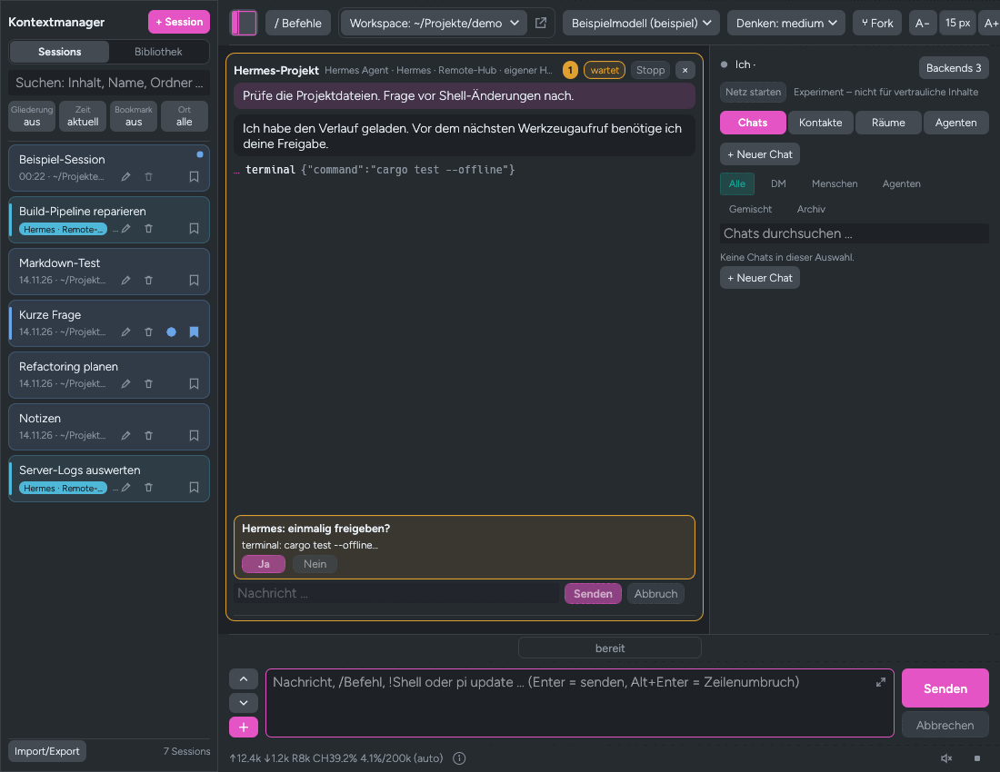

# Hermes-Agent-Steuerung in cocopi-v2

## Separate Ausgabe cocopi-h · Branch cocopi-v2b-hermes

Build und Installation ohne Ersatz der vorhandenen cocopi-/v3-Binaries:

```sh
CARGO_BUILD_JOBS=2 cargo test --offline --locked --release --manifest-path copi/Cargo.toml --features cocopi-h --bin cocopi-h
bash copi/scripts/install-cocopi-h.sh
```

Der Installer baut offline/locked mit zwei Jobs, prüft freien Platz, sichert
vorhandene gleichnamige Ziele und installiert atomar mit vollständigem SHA256-Abgleich.
`--skip-build` nur unmittelbar nach einem nachgewiesenen Build dieses Quellstands.
Ziele: `~/.local/bin/cocopi-h`, eigener Desktop-Eintrag `cocopi-h.desktop` und SVG
mit H-Plakette. Eigener Fenstername/App-ID `cocopi-h`; Launchpad-Kategorie **Agents**
über `Categories=Development;X-Agent;`. Kein Shell-/App-/Hub-Neustart nötig oder ausgeführt.

Die Ausgabe nutzt weiterhin die Konfiguration und Sessions des cocopi-Kerns;
sie ist **kein isoliertes Profil**. Dieselbe Session nicht gleichzeitig in beiden
Ausgaben bearbeiten. Es wird weder ein Hub noch Hermes automatisch gestartet.
Der direkte lokale pi-Backend bleibt verfügbar.

Installationsabnahme: 137 Release-Tests bestanden / 2 ignoriert. ARM-Release gebaut,
installiert und vollständig hashgeprüft, SHA256
`70e36f4c1c7ee864fbcb1365d17fd9d8a53053936b6ab5727e6d8f9a63e926b1`.
Desktop-Validator und installierter Launchpad-Klassifikator bestätigen Agents/GUIs;
Installer-Backup in isoliertem HOME geprüft. Keine App-/Shell-/Hub-Neustarts und
kein echter Modelllauf. Details in `HANDOFF.md`.

Desktop und eingebetteter Hub sind im pi-lite-Branch enthalten. Das eigenständige
pi-hub-Repository hat aktuell kein Remote; für dessen separaten Push fehlt ein Ziel.

## Was implementiert ist

Hermes wird als weiterer Harness eines **Hub-Backends** gesteuert. Lokal bedeutet:
Hub auf diesem Rechner, Backend-URL `http://127.0.0.1:8787`. Remote bedeutet: Hub
auf dem Hermes-Rechner, Zugriff über SSH-Tunnel/Tailscale/TLS. Der direkte lokale
pi-Backend-Eintrag bleibt unverändert und startet kein Hermes.

- „Neue Instanz“ lädt verfügbare Harnesses aus dem Backend, statt pi/mock zu raten.
- Mit konfiguriertem Hub erscheint **Hermes Agent**; neue API-Session oder eine der
  letzten 200 API-Sessions auswählen. Normale pi-Sessionliste bleibt unverändert.
- Steuerung in den bestehenden Chat-/Rasteransichten: Textstream, Werkzeuge,
  Status, Abbruch, einmalige Freigabe oder Ablehnung, Rückfragen mit Texteingabe.
- Einzelchat: pi-Modell-/Denkstufenwahl und Fork für Hermes deaktiviert; auch deren
  Tastenkürzel senden keine unpassenden pi-Befehle.
- Der Adapter beantwortet nicht unterstützte Kommandos ausdrücklich mit Fehler,
  statt sie still als erfolgreich zu quittieren.

## Wichtige Grenzen

**HUB_ROOTS ist keine Hermes-Shell-Sandbox.** Hermes nutzt seine Host-/Werkzeug-
Konfiguration. Die Ordnerwahl in cocopi verändert diese nicht. Der Dialog weist
darauf ausdrücklich hin. Hermes läuft nicht auf dem Client, wenn der Hub remote ist.

Es werden ausschließlich Hermes-API-Sessions gesteuert. Keine Übernahme laufender
CLI-/TUI-Sessions. Doppelte Öffnung derselben API-Session innerhalb des Hubs wird
abgewiesen. Fremde API-Clients können nicht durch den Hub allein ausgeschlossen
werden; es gelten zusätzlich die Hermes-seitigen Besitz-/Sessionregeln.

Hub-Token und Hermes-Key sind getrennt. Der Hermes-Key bleibt in der privaten
Hub-Umgebung; kein neues Secret-Feld in cocopi, kein Schlüssel im Chat/Repo.

## Hub einrichten (noch nicht auf echten Hosts ausgeführt)

Der Hub benötigt `server.mjs` **und** `hermes.mjs` aus dem Hermes-Arbeitsbranch
`cocopi-v2b-hermes` in `~/Work/pi-hub`. Variablen am Hub:

```text
HERMES_API_URL=http://127.0.0.1:8642
HERMES_API_KEY=<privater API_SERVER_KEY des Hermes-Gateways>
```

Hermes nach dessen API-Server-Dokumentation selbst konfigurieren und starten.
Es wird weder `.hermes/.env` automatisch verändert noch ein Gateway gestartet.
API lauscht nur auf Loopback; falls nötig, einen vorhandenen SSH-Tunnel verwenden.

Der eingebettete Hub in `copi/crates/pi-backend/hub/` enthält denselben Adapter.
SSH-Bootstrap stellt beide Module bereit. Bei laufendem, veraltetem Hub verweigert
es den Update-Neustart mit einem Wartungshinweis; laufende Agenten werden nicht
beendet. `.new`-Dateien sind nur Bereitstellung, noch keine aktivierte Installation.
Für den wirklichen Remoteeinsatz ein Wartungsfenster mit gesichertem Zustand und
privater Dienstumgebung vereinbaren. Kein R2-Checkout/Service wurde hier verändert.

## Vertrag und Teststand

Der Adapter nutzt die dokumentierte **Runs API**: erst Run-ID, dann SSE; Stop und
Rückfragen gehören immer zu genau diesem Run. Freigaben nur `once`/`deny` mit
exakter Request-ID und gegebenenfalls Ausführungsgeneration. Kein automatisches
Bestätigen und kein automatischer Prompt-Neuversand bei unklarem Ausführungszustand.
Nach Streamverlust Statuspolling, nicht einfach „fertig“ anzeigen. Entfernen einer
laufenden Instanz wartet nach Stop auf einen terminalen Status; andernfalls bleibt
sie erhalten. Zweiter Prompt/Steer gesperrt, Entwürfe bleiben bestehen. Hub-Registry
bewahrt Run-ID bzw. unklare Admission; Wiederaufnahme startet keinen zweiten Run.

Referenz: NousResearch/hermes-agent Commit
`cd92298898750af19feb72a3e6e7aff51f4bac12`; API-Server-Doku und REST-/Run-Implementierung.
Insbesondere heißt das Freigabe-Feature **`run_approval_response`**; `run_approval`
ist der Endpointname, kein zuverlässig existierendes Featureflag.

- `npm test` im separaten Hub-Repo: vorhandene Smoke-Suite plus Fake-Hermes-HTTP/SSE
  und Unit-Tests. Ausschließlich Fake-Keys, temporäre Daten, Push deaktiviert.
- Native Regression `hermes_control_scene_and_unsupported_main_actions`: wartende
  Hermes-Kachel, Rückfrage, keine pi-Denkstufen/Fork; Software-Screenshot mit Demodaten.
- Finale native Releaseprüfung: 136 bestanden / 2 ignoriert. Backend 89 Libtests
  (+1 ignoriert), 1 Hub- und 3 SSH-Integrationstests (+2 ignoriert) bestanden.
  Embedded-Module abschließend bytegleich zum Hub. Dieser Prüfstand vor der
  separaten cocopi-h-Ausgabe; deren Installationsprüfung siehe `HANDOFF.md`.
  Weitere Prüfresultate und Installationsstand: `HANDOFF.md`.


- Kein echter Hermes-/Modell-/SSH-/Mehrgeräte-Livetest und kein Security-Audit.

## GEPLANT, NICHT IMPLEMENTIERT

Slot-/Geräte-Protokoll v1 (nicht im lokalen Hub vorhanden), v3-Port,
Hermes-spezifischer Auswahl-/Sessiondialog in pi-lite/Web/Mobil, CLI-/TUI-Liveattach,
Fork/Clone, Modell-/Denkstufenwechsel, Anhänge, Hermes-Session-Löschung/-Umbenennung,
vollständiger Werkzeugverlauf und Subagent-Lifecycle-Normalisierung.

Ausführliche Adapter- und Betriebsdokumentation im Hub: `docs/HERMES.md`.
