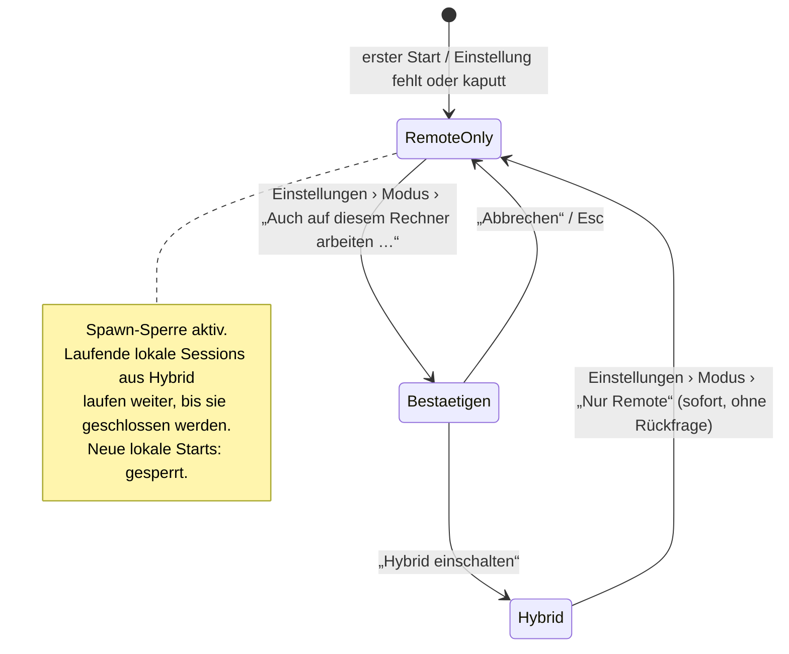

# cocopi v3 · Konzept (S1, I1)

Stand: I1, Basis `v3/s1` @ `eb534bb`. Die Abschnitte A2 und A3 sind **Entwürfe zur Freigabe**. A1 und A4 sind **Vorschläge** an S3 bzw. S4. Begriffe richten sich nach dem Tutorial: „R2“, „Konto“ = Slot `account01`–`account10`, „Gerät“.

---

## A2 · Moduslogik Remote-only ↔ Hybrid

### Zustände

| Zustand | Bedeutung | Lokales `pi` erlaubt? |
|---|---|---|
| **Nur Remote** (`RemoteOnly`) | Standard. Alles läuft auf R2. | **nein**, nie, auch offline |
| **Hybrid** (`Hybrid`) | Zusätzlich darf dieser Rechner `pi` starten. | ja |

Es gibt keinen dritten Zustand. Fehlt die Einstellung oder ist sie unlesbar, gilt **Nur Remote** (sichere Voreinstellung).



Regeln:
- **Bewusst:** Nach Hybrid geht es nur über einen Bestätigungsdialog. Zurück nach Nur Remote braucht keine Bestätigung, weil dieser Weg sicherer ist.
- **Umkehrbar, ohne laufende Sessions zu verändern** (E4): Ein Wechsel beendet nichts und startet nichts. Eine noch laufende lokale Session aus Hybrid bleibt sichtbar, bis sie geschlossen wird, und ist mit „Dieser Rechner“ markiert. Danach gibt es keinen neuen lokalen Start.
- **Kein Fallback:** Ist R2 nicht erreichbar, wird der Zustand „offline“ angezeigt, aber nie lokal gestartet. Das gilt in beiden Modi: Hybrid startet lokal nur, wenn die Nutzerin ausdrücklich „Dieser Rechner“ wählt.
- **Mobil:** Am Handy gibt es keinen Modus (§4.2). Das Handy startet nie `pi`.

### Die eine Code-Stelle (E4)

Heute gehen **alle** lokalen `pi`-Starts durch `pi_backend::winshim::pi_command(args)`. Belegt per `grep -rn pi_command copi/`:

| Aufrufer | Zweck |
|---|---|
| `rpc.rs:48` `Pi::start` | Haupt-Chat und `LocalInstances` |
| `cli.rs:53` `Cli::run` | `pi update`, `pi install` usw. aus der Eingabe |
| `cli.rs:189` `pi_version` | Versionsanzeige auf der Startkarte |
| `preview.rs:221` `ask_haiku` | KI-Hilfsmodell (Zweck, Tokenerklärung) |

Vorschlag (für S2 umzusetzen): Die Sperre liegt **in** dieser Funktion. Damit gibt es keinen Weg an ihr vorbei.

```rust
// copi/crates/pi-backend/src/mode.rs  (neu)
#[derive(Clone, Copy, PartialEq, Eq, Debug, Serialize, Deserialize)]
#[serde(rename_all = "snake_case")]
pub enum Mode { RemoteOnly, Hybrid }

/// Prozessweit; Startwert RemoteOnly (fail closed), bevor irgendetwas geladen ist.
pub fn current() -> Mode;
/// Liest `<copi_config_dir>/mode.json`; fehlt/kaputt ⇒ RemoteOnly. Einmal in `main()` vor dem ersten Frame.
pub fn init() -> Mode;
/// Speichert atomar (0600) und setzt `current()`. Nur aus Einstellungen › Modus aufgerufen.
pub fn set(m: Mode) -> Result<(), String>;

#[derive(Debug)]
pub struct SpawnBlocked { pub purpose: SpawnPurpose }   // Display: Text aus Tabelle unten

#[derive(Clone, Copy, Debug)]
pub enum SpawnPurpose { Chat, Cli, Version, Helper }

// copi/crates/pi-backend/src/winshim.rs  (geändert, beide cfg-Zweige)
/// EINZIGE Stelle, an der copi `pi` als Prozess erzeugt. Prüft vor dem Bau des Commands.
pub fn pi_command(purpose: SpawnPurpose, args: &[String]) -> Result<Command, SpawnBlocked>;
```

- Die Prüfung `if mode::current() != Mode::Hybrid { return Err(SpawnBlocked{purpose}) }` steht als **erste Zeile** in `pi_command`.
- `mode.json` ist eine eigene Datei. Sie steht bewusst nicht in `state.json` der App, damit `pi-backend` sie ohne Abhängigkeit von der App lesen kann. Inhalt: `{"mode":"remote_only"}`.
- **Hilfsregeln** sind keine zweite Sperre, sie **verbergen** nur:
  - Bei `RemoteOnly` lässt `backends::parse` den Eintrag `kind:"local"` weg und fügt ihn nicht mehr automatisch ein. Heute geschieht das in `backends.rs:83`, `:89` und `:92`.
  - `net.rs:588` ersetzt im Fehlerfall nicht mehr durch `BackendCfg::local()`. Stattdessen gilt: leere Liste und die Meldung „Verbindungsliste unlesbar“.
  - Die Startkarte ruft `pi_version`/`latest_version` nicht auf (siehe INVENTAR #26).
- **Nicht** gesperrt werden `ssh`, `rsync`, `curl`, Editor, `pdftotext` und Piper. Das sind keine Agenten. Sie fallen aber in den Inventar-Streichungen weg, soweit sie nur für lokale Funktionen da waren.
- **Prüfbar:** Der Quelltext-Test `only_winshim_spawns_pi` verlangt, dass `Command::new("pi")` außerhalb von `winshim.rs` nicht vorkommt. Siehe ACCEPTANCE.

### Anzeige

- **Statuszeile, links, immer** (Regel 8, leise):
  - `☁ Nur Remote · Mira · account03 @ R2 · verbunden`
  - `⇄ Hybrid · Mira · account03 @ R2 · verbunden`
  - Farbe: neutral bei Nur Remote; bei Hybrid ein dezenter Akzent, **kein** Rot, denn Hybrid ist kein Fehler.
- **Klick auf das Feld** öffnet Einstellungen › Modus. Das ist eine Abkürzung, kein zweiter Ort.
- **Einstellungen › Modus**, Texte wörtlich:
  - Überschrift: **Wo arbeitet der Agent?**
  - Auswahl 1: **Nur auf R2 (empfohlen)** – „Auf diesem Rechner wird kein Agent gestartet. Deine Arbeit läuft auf dem Seminarserver.“
  - Auswahl 2: **Auch auf diesem Rechner (Hybrid) …** – „Für Fortgeschrittene. Dafür muss pi auf diesem Rechner installiert sein.“
- **Bestätigungsdialog Hybrid:**
  - Titel: **Auch auf diesem Rechner arbeiten?**
  - Text: „Dann kann cocopi hier einen Agenten starten. Er hat Zugriff auf die Dateien dieses Rechners. Laufende Sessions bleiben, wie sie sind. Du kannst jederzeit zurückschalten.“
  - Knöpfe: **[Abbrechen]** (Standard, Esc) und **[Hybrid einschalten]**.
- **Meldung bei gesperrtem Start** (`SpawnBlocked`, darf im Normalbetrieb nicht vorkommen):
  - „**Hier startet kein Agent.** cocopi ist auf ‚Nur Remote‘ gestellt. Deine Sessions laufen auf R2.“
  - Knopf: **[Einstellungen öffnen]**.
- **Fehlende Fähigkeit:** Zum Beispiel nutzt jemand eine lokale Funktion bei Nur Remote. Dann erklärt die Meldung, dass die Funktion nur bei Hybrid geht. **Nie** wird etwas installiert (T1).

---

## A3 · QR-Ablauf: ein Mechanismus für Login, Koppeln, Bestätigen

### Grundform

- Jede der drei Arten erzeugt **einen Einmalcode**. Er wird als QR **und** als tippbarer Text gezeigt.
  - **Einladung:** der Admin erzeugt den Code.
  - **Koppeln:** der angemeldete Desktop erzeugt den Code.
  - **Bestätigen:** der Desktop erzeugt den Code.
- Der Code ist eine HTTPS-URL. Der Code steht im **Fragment** (`#`), damit er nicht in Server- oder Proxy-Logs landet.

```
https://<r2-host>/c#1.<art>.<code>
  1      = Format-Version
  <art>  = e (Einladung) | k (Koppeln) | b (Bestätigen)
  <code> = 16 Zeichen Crockford-Base32 (80 Bit Zufall), angezeigt als K7QM-2XDA-9FHT-W3NB
```

- Wer die URL ohne cocopi öffnet, sieht eine statische Seite. Diese Seite schickt nichts ab und sagt nur: „Öffne diesen Link in cocopi.“
- Der `<r2-host>` ist ein Platzhalter. Laut Tutorial ist „R2“ kein verifizierter DNS-Name. S3/S4 legen den Host fest.

| Art | Erzeugt von | Eingelöst von | Gültig | Einmalig | Ergebnis |
|---|---|---|---|---|---|
| **e** Einladung | Admin (`cocopi-admin einladung account03 --name "Mira"`) | neues Gerät: Desktop per Link/Code, Handy per Scan | **24 h** | ja | Gerät wird für **diesen Slot** registriert |
| **k** Koppeln | angemeldeter Desktop, Einstellungen › Geräte | Handy (Scan) | **5 min** | ja | Handy wird für denselben Slot registriert, **nachdem der Desktop zustimmt** |
| **b** Bestätigen | Desktop, wenn eine Aktion Bestätigung braucht | gekoppeltes Handy desselben Slots (Scan) | **2 min** | ja | Die Aktion wird freigegeben. |

Was am Desktop eine Bestätigung braucht:
- I1: die Anmeldung eines **weiteren Desktops** für denselben Slot.
- Später: riskante Freigaben (MCP, Publishing).

Regeln für den Hub (an S3):
- Der Hub speichert nur `sha256(code)`, die Art, den Slot, `gültig_bis` und `verbraucht`.
- **Einlösen ist atomar:** ein Compare-and-set auf `verbraucht`. Zwei gleichzeitige Versuche ergeben einmal Erfolg und einmal „schon benutzt“.
- **Drosselung:** höchstens 5 Fehlversuche pro Minute je Absender. Nach 10 Fehlversuchen auf einen Code ist der Code gesperrt.
- Ein **neuer** Koppel-Code ersetzt den vorigen, **noch nicht benutzten** Code desselben Desktops. Das entspricht Orca `remote-servers.mdx`.

### Geräte-Token je Person + Slot

- Das Gerät erzeugt beim Einlösen ein **Schlüsselpaar** (Ed25519). Der **private Schlüssel bleibt im Gerät**:
  - macOS: Keychain;
  - iOS/Android: Keychain bzw. Keystore;
  - Linux: Datei mit 0600 und Hinweis.
- Gesendet wird nur der öffentliche Schlüssel.
- Der Hub legt einen Geräteeintrag an:
  `{geraet_id, slot, anzeigename_person, art: desktop|handy, geraetename, pubkey, erstellt, zuletzt_gesehen, widerrufen}`.
- **Rechte hängen nur am Slot.** Wird die Person umbenannt, ändern sich keine Rechte (T2). Der Slot steht im Eintrag fest; ein Gerät kann keinen anderen Slot anfragen.
- **Anmeldung pro Verbindung:** Der Hub schickt eine Zufallszahl (Nonce), das Gerät signiert sie. Der Hub gibt dann ein kurzlebiges Zugangstoken aus (12 h, an `geraet_id` gebunden). Den Ablauf legt S3 fest.
- **Widerruf an einer Stelle:**
  - für Nutzerinnen: **Einstellungen › Geräte** am Desktop;
  - für den Admin: `cocopi-admin geraete account03 --widerrufen <id>`.
  - Wirkung: Eintrag `widerrufen`, alle Zugangstokens ungültig, offene SSE-/WebSocket-Verbindungen dieses Geräts werden **sofort** geschlossen.
  - Am Handy gibt es nur „Dieses Handy abmelden“. Das löscht den eigenen Schlüssel und meldet das eigene Gerät ab. Fremde Geräte lassen sich dort nicht widerrufen.

### Abläufe und Bildschirmtexte (wörtlich)

#### 1 · Anmelden mit Einladung (Desktop)

1. **Startkarte**, wenn noch kein Gerät angemeldet ist:
   - Titel: **Willkommen bei cocopi**
   - Text: „Du hast eine Einladung bekommen – als Link oder als QR-Code. Öffne den Link, oder füge ihn hier ein.“
   - Feld: *Einladungslink oder Code*
   - Knopf: **[Anmelden]**
   - Leise Zusatzzeile: „Keine Einladung? Frag deine Seminarleitung.“
2. Nach **[Anmelden]** sieht man: „Einladung wird geprüft …“ mit Fortschritt ohne Prozentangabe.
3. **Erfolg:** „**Angemeldet als Mira · account03 @ R2.** Dieser Rechner heißt jetzt ‚Miras MacBook‘.“ Daneben die Knöpfe **[Name ändern]** und **[Los geht’s]**.
   - Die Statuszeile zeigt ab jetzt `☁ Nur Remote · Mira · account03 @ R2`.
4. **Fehlertexte** folgen der Form „Was ist passiert. Was kann ich tun.“:
   - abgelaufen: „**Diese Einladung ist abgelaufen.** Bitte deine Seminarleitung um eine neue.“
   - verbraucht: „**Diese Einladung wurde schon benutzt.** Jede Einladung gilt nur einmal. Wenn du das nicht warst, sag deiner Seminarleitung Bescheid.“
   - unbekannt oder vertippt: „**Dieser Code passt zu keiner Einladung.** Prüfe die Zeichen oder öffne den Link direkt.“
   - R2 nicht erreichbar: „**R2 ist gerade nicht erreichbar.** Prüfe deine Internetverbindung. Die Einladung bleibt gültig bis {Datum, Uhrzeit}.“
   - Zu viele Versuche: „**Zu viele Versuche.** Warte eine Minute und versuche es dann noch einmal.“

Wird eine Einladung auf einem **zweiten Desktop** für einen Slot eingelöst, der schon ein Gerät hat, braucht es zusätzlich Ablauf 3 („Bestätigen“), falls ein Handy gekoppelt ist. Ohne gekoppeltes Handy gilt die Einladung selbst als Bestätigung, denn der Admin hat sie bewusst ausgestellt.

#### 2 · Handy koppeln

1. **Desktop, Einstellungen › Geräte:** Knopf **[Handy koppeln]**.
2. **Desktop-Dialog:**
   - Titel: **Handy koppeln**
   - QR-Code, darunter der Code `K7QM-2XDA-9FHT-W3NB`
   - Text: „Öffne cocopi auf deinem Handy und tippe auf ‚Mit Rechner koppeln‘. Scanne dann diesen Code. Er gilt 5 Minuten.“
   - Countdown „noch 4:12“, Knopf **[Abbrechen]**.
3. **Handy** (erster Start oder Einstellungen):
   - Knopf **[Mit Rechner koppeln]** → Kamera-Ansicht mit der Zeile „Halte die Kamera auf den Code am Rechner.“
   - Zusätzlich der Link **Code eintippen**.
4. **Handy nach dem Scan:** „Warte auf Bestätigung am Rechner …“
5. **Desktop:**
   - Text: „**Neues Gerät möchte sich verbinden:** ‚Pixel 7‘. Ist das dein Handy?“
   - Knöpfe **[Ablehnen]** und **[Erlauben]**.
   - Prüfwort an beiden Geräten: „Prüfwort: **Ahorn · Kiesel**“. Das Muster stammt aus den cocopi-Kontakten (INVENTAR #55).
6. **Erfolg:**
   - Handy: „**Gekoppelt mit account03 @ R2.**“
   - Desktop: Das Gerät erscheint in der Liste.
7. **Fehler:**
   - abgelaufen: „**Der Code ist abgelaufen.** Tippe am Rechner noch einmal auf ‚Handy koppeln‘.“
   - abgelehnt (Handy): „**Der Rechner hat abgelehnt.** Es wurde nichts gespeichert.“
   - schon benutzt: „**Dieser Code wurde schon benutzt.** Erzeuge am Rechner einen neuen.“

#### 3 · Rechner per Handy bestätigen

1. **Desktop,** in dem Moment, in dem die Aktion es verlangt:
   - Titel: **Bitte am Handy bestätigen**
   - QR-Code
   - Text: „Scanne den Code mit deinem gekoppelten Handy. Gilt 2 Minuten.“
   - Knopf **[Abbrechen]**.
2. **Handy:**
   - Zuerst: „**Bestätigen?** Neuer Rechner ‚Atelier-iMac‘ möchte account03 nutzen.“
   - Knöpfe **[Nein]** und **[Bestätigen]**.
   - Die Beschreibung der Aktion kommt **vom Hub**, nicht aus dem QR. Damit kann der QR nichts vortäuschen.
3. **Erfolg:**
   - Desktop: „**Bestätigt.**“ Danach geht die Aktion weiter.
   - Handy: „Erledigt. Du kannst das Handy weglegen.“
4. **Fehler:**
   - fremdes Handy (anderer Slot): „**Dieses Handy gehört zu einem anderen Konto.** Nutze das Handy, das mit account03 gekoppelt ist.“
   - abgelaufen: wie oben.

#### 4 · Gerät widerrufen (Einstellungen › Geräte)

- Jede Zeile der Liste hat diese Form: „**Pixel 7** · Handy · zuletzt aktiv heute 14:02 · [Abmelden …]“
- Das eigene Gerät ist markiert mit „(dieser Rechner)“.
- **Dialog:**
  - Text: „**‚Pixel 7‘ abmelden?** Das Gerät verliert sofort den Zugang zu account03. Um es wieder zu nutzen, musst du es neu koppeln.“
  - Knöpfe **[Abbrechen]** und **[Abmelden]**. Der Abmelde-Knopf ist als gefährliche Aktion gestaltet.
- **Auf dem widerrufenen Gerät:** „**Dieses Gerät wurde abgemeldet.** Melde dich mit einer neuen Einladung oder durch Koppeln wieder an.“

---

## A1 · Skizze Protokoll `shared/protocol/v1` (Vorschlag an S3, Freigabe S1)

### Versionierung

Das Muster ist Orca `mobile/src/transport/protocol-version.ts` nachgebaut.

- **Ganze Zahl** `protokoll`.
  - Sie wird **nur erhöht**, wenn sich die Bedeutung einer Nachricht ändert.
  - Neue, optionale Felder erhöhen sie nicht.
- **Handschlag:**
  - Client: `hallo {protokoll, app:"cocopi-desktop 3.0.0", geraet_id}`
  - Hub: `willkommen {protokoll, min_client, slot, person, hub_version}`
- **Bei Abweichung** gibt es einen festen Text:
  - Client zu alt: „**cocopi muss aktualisiert werden.** R2 spricht eine neuere Sprache. Lade die neue Version von {Ort} herunter.“
  - Hub zu alt: „**R2 ist noch nicht auf dem neuesten Stand.** Sag der Seminarleitung Bescheid. Deine Sessions sind sicher.“

### Nachrichten (Kern I1)

| Richtung | Nachricht | Felder (Auszug) |
|---|---|---|
| C→H | `sessions.liste` | – |
| C→H | `session.oeffnen` | `session_id?` (neu, wenn leer), `workspace` |
| C→H | `session.senden` | `session_id`, `text`, `art: auftrag\|nachsteuern` |
| C→H | `session.stopp` | `session_id` |
| C→H | `rueckfrage.antwort` | `session_id`, `frage_id`, `wert` |
| C→H | `session.ruhen` | `session_id` |
| H→C | `session.zustand` | `session_id`, `zustand`, `seit`, `frage?`, `titel`, `workspace` |
| H→C | `session.ereignis` | `session_id`, `pi_event` (Durchreiche, Felder wie heute in `net.js`) |
| H→C | `fehler` | `code`, `was`, `tun` (beide Texte für Menschen) |
| H↔C | `puls` | `t` – alle **15 s**. Nach 45 s ohne Puls zeigt der Client „Verbindung unterbrochen“ und graut alle Zustände aus, mit dem Zusatz „Stand 14:02“. |

### Zustand einer Session (eine Quelle, Desktop = Mobil)

Der Zustand wird nur im Hub berechnet. Die Clients zeigen ihn an und zählen nichts selbst.

| Zustand (Anzeige) | Hub heute (`server.mjs`) | zählt als „offen“ (T3) | Anzeige |
|---|---|---|---|
| **ruht** | (neu) Prozess beendet, Session-Datei da (Hibernation) | nein | grau, „ruht“ |
| **arbeitet** | `starting`, `busy` | ja | Akzentfarbe, „arbeitet · 2:14“ |
| **wartet auf dich** | `waiting` | ja | Signalfarbe + Benachrichtigung, „wartet auf dich“ |
| **fertig** | `idle` nach `agent_end`, noch nicht angesehen | ja | Häkchen, „fertig“ |
| **bereit** | `idle`, schon angesehen | ja | ohne Markierung |
| **Fehler** | `exited` ohne Ruhen-Auftrag | nein | „Fehler – {was}“ + **[Neu öffnen]** |

Bei „bereit“ sieht man keine Extra-Markierung: Das ist „fertig“ nach dem Ansehen. Fünf sichtbare Zustände passen zu Prompt §4.3; „bereit“ ist der neutrale Normalfall.

**Grenze (T3):**
- Höchstens 2 Sessions „offen“ und höchstens 1 „arbeitet“.
- Eine dritte `session.oeffnen` beantwortet der Hub mit `fehler{code:"zu_viele_offen"}`. Text:
  - „**Du hast schon 2 offene Sessions.** Lass eine ruhen, dann kannst du diese öffnen. Es geht nichts verloren.“
  - Knopf: **[‚{Titel}‘ ruhen lassen]** für die älteste nicht arbeitende Session.

---

## A4 · Skizze Kontomodell R2 (Vorschlag an S4/S3, Freigabe S1)

```
Person (Anzeigename, änderbar)
  └─ Slot accountNN (fest, 01–09; 10 = Reserve)
       ├─ Unix-Konto accountNN (kein sudo, keine docker-Gruppe, Quote 80 GB)
       │    └─ systemd user@UID.service (Linger) in user-UID.slice: CPUQuota, MemoryMax, TasksMax
       │         └─ pi-hub (systemd --user), bindet 127.0.0.1:87NN, eigenes Hub-Token
       │              ├─ pi-Prozesse (bedarfsgesteuert, ruhen nach 30 min fertig)
       │              ├─ Sessions ~/.pi/agent/sessions (höchstens 2 offen, 1 arbeitet – im Hub erzwungen)
       │              └─ Geräte-Register ~/.config/pi-hub/geraete.json (nur Geräte DIESES Slots)
       └─ Geräte: Desktop(s), Handy(s) – je Ed25519-Schlüssel, widerrufbar
```

| Bindung | Wo festgehalten | Wer ändert |
|---|---|---|
| Person ↔ Slot | Admin-Inventar (Tutorial Kap. 7) und `person` im Geräte-Register | Admin |
| Slot ↔ Unix-Konto | gleicher Name `accountNN` | fest (Provisionierung S4) |
| Unix-Konto ↔ Hub | ein Hub je Konto, Port `8700+NN` | fest (S4) |
| Hub ↔ außen | TLS-Vorschaltung (Tailscale oder Proxy) leitet je Slot auf `127.0.0.1:87NN`. Den Weg wählt S3/S4. | Admin |
| Slot ↔ Gerät | Geräte-Register im Hub des Slots | Einladung, Koppeln, Widerruf (A3) |

Folgen:
- **Fremde Konten sind nicht wählbar**, und das schon durch den Aufbau: Jeder Hub kennt nur seine eigenen Geräte.
- **Sessiongrenze je Konto:** Ein Prozess pro Konto ist der Hub. Er kann parallele Starts mit einer Sperre in diesem Prozess atomar behandeln (T3).
- **Globale CPU-Queue:** Sie gilt über alle Hubs und braucht eine gemeinsame Stelle, etwa `flock` auf `/run/cocopi/cpu.lock` (Gruppe `cocopi`). Die Entscheidung liegt bei S3/S4.
- **Grenze erreicht** (MemoryMax/TasksMax): Der Hub übersetzt das Kill-Signal in `fehler{code:"speicher_grenze"}`. Text: „**Diese Aufgabe brauchte mehr Speicher, als dein Konto hat.** Teile sie in kleinere Schritte, oder frag die Seminarleitung.“
- **Wiedervergabe eines Slots:** Daten exportieren, alle Geräte widerrufen, Home leeren, neue Einladung ausstellen (Tutorial Kap. 7).
