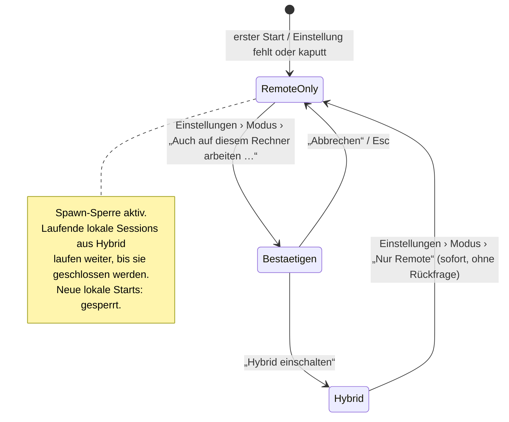
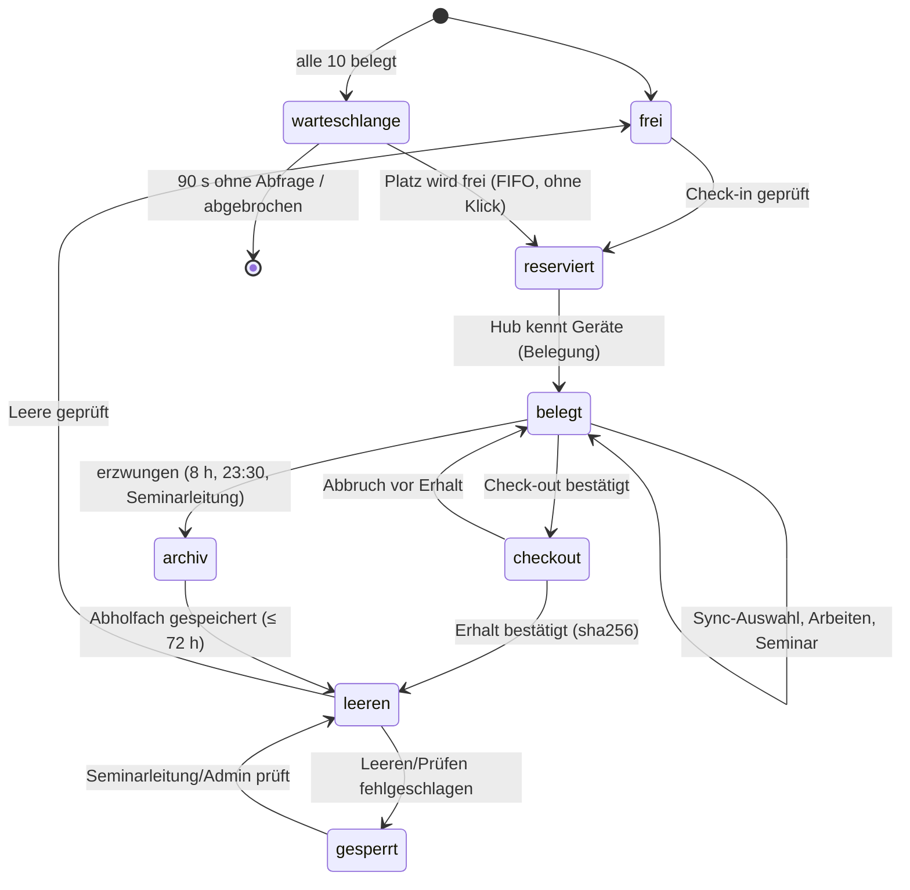

# cocopi v3 · Konzept (S1, Fassung 2 · I2)

Stand: Fassung 2 (I2), Basis `v3/s1` @ `e8f000e` (FREEZE-I2).
- **Teil A** (I1): A1–A4. A2 und A3 gelten weiter. A1 wird in I2 additiv erweitert (`shared/protocol/v1/PROTOKOLL.md` §I2).
- **A4 ist ersetzt durch E7** (Pool statt fester Konten). Der Abschnitt bleibt als Nachweis stehen.
- **Teil B** (I2): Pool, Check-in/Check-out, authentik, Sync, No-Retention (E7–E10, A6–A9).

Begriffe: siehe `GLOSSAR.md`. Kurz: „R2“, „Arbeitsplatz“ = eines der Konten `account01`–`account10` aus dem Pool, „Gerät“, „Empfang“.

# Teil A · Grundlagen (I1)

---

## A2 · Moduslogik Remote-only ↔ Hybrid

### Zustände

| Zustand | Bedeutung | Lokales `pi` erlaubt? |
|---|---|---|
| **Nur Remote** (`RemoteOnly`) | Standard. Alles läuft auf R2. | **nein**, nie, auch offline |
| **Hybrid** (`Hybrid`) | Zusätzlich darf dieser Rechner `pi` starten. | ja |

Es gibt keinen dritten Zustand. Fehlt die Einstellung oder ist sie unlesbar, gilt **Nur Remote** (sichere Voreinstellung).



Regeln:
- **Bewusst:** Nach Hybrid geht es nur über einen Bestätigungsdialog. Zurück nach Nur Remote braucht keine Bestätigung, weil dieser Weg sicherer ist.
- **Umkehrbar, ohne laufende Sessions zu verändern** (E4): Ein Wechsel beendet nichts und startet nichts. Eine noch laufende lokale Session aus Hybrid bleibt sichtbar, bis sie geschlossen wird, und ist mit „Dieser Rechner“ markiert. Danach gibt es keinen neuen lokalen Start.
- **Kein Fallback:** Ist R2 nicht erreichbar, wird der Zustand „offline“ angezeigt, aber nie lokal gestartet. Das gilt in beiden Modi: Hybrid startet lokal nur, wenn die Nutzerin ausdrücklich „Dieser Rechner“ wählt.
- **Mobil:** Am Handy gibt es keinen Modus (§4.2). Das Handy startet nie `pi`.

### Die eine Code-Stelle (E4)

Heute gehen **alle** lokalen `pi`-Starts durch `pi_backend::winshim::pi_command(args)`. Belegt per `grep -rn pi_command copi/`:

| Aufrufer | Zweck |
|---|---|
| `rpc.rs:48` `Pi::start` | Haupt-Chat und `LocalInstances` |
| `cli.rs:53` `Cli::run` | `pi update`, `pi install` usw. aus der Eingabe |
| `cli.rs:189` `pi_version` | Versionsanzeige auf der Startkarte |
| `preview.rs:221` `ask_haiku` | KI-Hilfsmodell (Zweck, Tokenerklärung) |

Vorschlag (für S2 umzusetzen): Die Sperre liegt **in** dieser Funktion. Damit gibt es keinen Weg an ihr vorbei.

```rust
// copi/crates/pi-backend/src/mode.rs  (neu)
#[derive(Clone, Copy, PartialEq, Eq, Debug, Serialize, Deserialize)]
#[serde(rename_all = "snake_case")]
pub enum Mode { RemoteOnly, Hybrid }

/// Prozessweit; Startwert RemoteOnly (fail closed), bevor irgendetwas geladen ist.
pub fn current() -> Mode;
/// Liest `<copi_config_dir>/mode.json`; fehlt/kaputt ⇒ RemoteOnly. Einmal in `main()` vor dem ersten Frame.
pub fn init() -> Mode;
/// Speichert atomar (0600) und setzt `current()`. Nur aus Einstellungen › Modus aufgerufen.
pub fn set(m: Mode) -> Result<(), String>;

#[derive(Debug)]
pub struct SpawnBlocked { pub purpose: SpawnPurpose }   // Display: Text aus Tabelle unten

#[derive(Clone, Copy, Debug)]
pub enum SpawnPurpose { Chat, Cli, Version, Helper }

// copi/crates/pi-backend/src/winshim.rs  (geändert, beide cfg-Zweige)
/// EINZIGE Stelle, an der copi `pi` als Prozess erzeugt. Prüft vor dem Bau des Commands.
pub fn pi_command(purpose: SpawnPurpose, args: &[String]) -> Result<Command, SpawnBlocked>;
```

- Die Prüfung `if mode::current() != Mode::Hybrid { return Err(SpawnBlocked{purpose}) }` steht als **erste Zeile** in `pi_command`.
- `mode.json` ist eine eigene Datei. Sie steht bewusst nicht in `state.json` der App, damit `pi-backend` sie ohne Abhängigkeit von der App lesen kann. Inhalt: `{"mode":"remote_only"}`.
- **Hilfsregeln** sind keine zweite Sperre, sie **verbergen** nur:
  - Bei `RemoteOnly` lässt `backends::parse` den Eintrag `kind:"local"` weg und fügt ihn nicht mehr automatisch ein. Heute geschieht das in `backends.rs:83`, `:89` und `:92`.
  - `net.rs:588` ersetzt im Fehlerfall nicht mehr durch `BackendCfg::local()`. Stattdessen gilt: leere Liste und die Meldung „Verbindungsliste unlesbar“.
  - Die Startkarte ruft `pi_version`/`latest_version` nicht auf (siehe INVENTAR #26).
- **Nicht** gesperrt werden `ssh`, `rsync`, `curl`, Editor, `pdftotext` und Piper. Das sind keine Agenten. Sie fallen aber in den Inventar-Streichungen weg, soweit sie nur für lokale Funktionen da waren.
- **Prüfbar:** Der Quelltext-Test `only_winshim_spawns_pi` verlangt, dass `Command::new("pi")` außerhalb von `winshim.rs` nicht vorkommt. Siehe ACCEPTANCE.

### Anzeige

- **Statuszeile, links, immer** (Regel 8, leise):
  - `☁ Nur Remote · Mira · account03 @ R2 · verbunden`
  - `⇄ Hybrid · Mira · account03 @ R2 · verbunden`
  - Farbe: neutral bei Nur Remote; bei Hybrid ein dezenter Akzent, **kein** Rot, denn Hybrid ist kein Fehler.
- **Klick auf das Feld** öffnet Einstellungen › Modus. Das ist eine Abkürzung, kein zweiter Ort.
- **Einstellungen › Modus**, Texte wörtlich:
  - Überschrift: **Wo arbeitet der Agent?**
  - Auswahl 1: **Nur auf R2 (empfohlen)** – „Auf diesem Rechner wird kein Agent gestartet. Deine Arbeit läuft auf dem Seminarserver.“
  - Auswahl 2: **Auch auf diesem Rechner (Hybrid) …** – „Für Fortgeschrittene. Dafür muss pi auf diesem Rechner installiert sein.“
- **Bestätigungsdialog Hybrid:**
  - Titel: **Auch auf diesem Rechner arbeiten?**
  - Text: „Dann kann cocopi hier einen Agenten starten. Er hat Zugriff auf die Dateien dieses Rechners. Laufende Sessions bleiben, wie sie sind. Du kannst jederzeit zurückschalten.“
  - Knöpfe: **[Abbrechen]** (Standard, Esc) und **[Hybrid einschalten]**.
- **Meldung bei gesperrtem Start** (`SpawnBlocked`, darf im Normalbetrieb nicht vorkommen):
  - „**Hier startet kein Agent.** cocopi ist auf ‚Nur Remote‘ gestellt. Deine Sessions laufen auf R2.“
  - Knopf: **[Einstellungen öffnen]**.
- **Fehlende Fähigkeit:** Zum Beispiel nutzt jemand eine lokale Funktion bei Nur Remote. Dann erklärt die Meldung, dass die Funktion nur bei Hybrid geht. **Nie** wird etwas installiert (T1).

---

## A3 · QR-Ablauf: ein Mechanismus für Login, Koppeln, Bestätigen

### Grundform

- Jede der drei Arten erzeugt **einen Einmalcode**. Er wird als QR **und** als tippbarer Text gezeigt.
  - **Einladung:** der Admin erzeugt den Code.
  - **Koppeln:** der angemeldete Desktop erzeugt den Code.
  - **Bestätigen:** der Desktop erzeugt den Code.
- Der Code ist eine HTTPS-URL. Der Code steht im **Fragment** (`#`), damit er nicht in Server- oder Proxy-Logs landet.

```
https://<r2-host>/c#1.<art>.<code>
  1      = Format-Version
  <art>  = e (Einladung) | k (Koppeln) | b (Bestätigen)
  <code> = 16 Zeichen Crockford-Base32 (80 Bit Zufall), angezeigt als K7QM-2XDA-9FHT-W3NB
```

- **Risiko, Prüfung durch S5:**
  - Orca setzt den Code bewusst in die Query (`orca://pair?code=`). Begründung in `src/shared/pairing.ts:25`: Android-Kamera-Intents erhalten Query-Parameter zuverlässiger als Fragmente.
  - Falls S5 das mit Tauri-Mobile bestätigt, gilt `?c=` statt `#`.
  - Der Code ist ohnehin einmalig und kurzlebig. Der Hub darf ihn dann aber **nicht loggen**; das ist ein Testfall.
- Wer die URL ohne cocopi öffnet, sieht eine statische Seite. Diese Seite schickt nichts ab und sagt nur: „Öffne diesen Link in cocopi.“
- Der `<r2-host>` ist ein Platzhalter. Laut Tutorial ist „R2“ kein verifizierter DNS-Name. S3/S4 legen den Host fest.

| Art | Erzeugt von | Eingelöst von | Gültig | Einmalig | Ergebnis |
|---|---|---|---|---|---|
| **e** Einladung | Admin (`cocopi-admin einladung account03 --name "Mira"`) | neues Gerät: Desktop per Link/Code, Handy per Scan | **24 h** | ja | Gerät wird für **diesen Slot** registriert |
| **k** Koppeln | angemeldeter Desktop, Einstellungen › Geräte | Handy (Scan) | **5 min** | ja | Handy wird für denselben Slot registriert, **nachdem der Desktop zustimmt** |
| **b** Bestätigen | Desktop, wenn eine Aktion Bestätigung braucht | gekoppeltes Handy desselben Slots (Scan) | **2 min** | ja | Die Aktion wird freigegeben. |

Was am Desktop eine Bestätigung braucht:
- I1: die Anmeldung eines **weiteren Desktops** für denselben Slot.
- Später: riskante Freigaben (MCP, Publishing).

Regeln für den Hub (an S3):
- Der Hub speichert nur `sha256(code)`, die Art, den Slot, `gültig_bis` und `verbraucht`.
- **Einlösen ist atomar:** ein Compare-and-set auf `verbraucht`. Zwei gleichzeitige Versuche ergeben einmal Erfolg und einmal „schon benutzt“.
- **Drosselung:** höchstens 5 Fehlversuche pro Minute je Absender. Nach 10 Fehlversuchen auf einen Code ist der Code gesperrt.
- Ein **neuer** Koppel-Code ersetzt den vorigen, **noch nicht benutzten** Code desselben Desktops. Das entspricht Orca `remote-servers.mdx`.

### Geräte-Token je Person + Slot

- Das Gerät erzeugt beim Einlösen ein **Schlüsselpaar** (Ed25519). Der **private Schlüssel bleibt im Gerät**:
  - macOS: Keychain;
  - iOS/Android: Keychain bzw. Keystore;
  - Linux: Datei mit 0600 und Hinweis.
- Gesendet wird nur der öffentliche Schlüssel.
- Der Hub legt einen Geräteeintrag an:
  `{geraet_id, slot, anzeigename_person, art: desktop|handy, geraetename, pubkey, erstellt, zuletzt_gesehen, widerrufen}`.
- **Rechte hängen nur am Slot.** Wird die Person umbenannt, ändern sich keine Rechte (T2). Der Slot steht im Eintrag fest; ein Gerät kann keinen anderen Slot anfragen.
- **Anmeldung pro Verbindung:** Der Hub schickt eine Zufallszahl (Nonce), das Gerät signiert sie. Der Hub gibt dann ein kurzlebiges Zugangstoken aus (12 h, an `geraet_id` gebunden). Den Ablauf legt S3 fest.
- **Widerruf an einer Stelle:**
  - für Nutzerinnen: **Einstellungen › Geräte** am Desktop;
  - für den Admin: `cocopi-admin geraete account03 --widerrufen <id>`.
  - Wirkung: Eintrag `widerrufen`, alle Zugangstokens ungültig, offene SSE-/WebSocket-Verbindungen dieses Geräts werden **sofort** geschlossen.
  - Am Handy gibt es nur „Dieses Handy abmelden“. Das löscht den eigenen Schlüssel und meldet das eigene Gerät ab. Fremde Geräte lassen sich dort nicht widerrufen.

### Abläufe und Bildschirmtexte (wörtlich)

#### 1 · Anmelden mit Einladung (Desktop)

1. **Startkarte**, wenn noch kein Gerät angemeldet ist:
   - Titel: **Willkommen bei cocopi**
   - Text: „Du hast eine Einladung bekommen – als Link oder als QR-Code. Öffne den Link, oder füge ihn hier ein.“
   - Feld: *Einladungslink oder Code*
   - Knopf: **[Anmelden]**
   - Leise Zusatzzeile: „Keine Einladung? Frag deine Seminarleitung.“
2. Nach **[Anmelden]** sieht man: „Einladung wird geprüft …“ mit Fortschritt ohne Prozentangabe.
3. **Erfolg:** „**Angemeldet als Mira · account03 @ R2.** Dieser Rechner heißt jetzt ‚Miras MacBook‘.“ Daneben die Knöpfe **[Name ändern]** und **[Los geht’s]**.
   - Die Statuszeile zeigt ab jetzt `☁ Nur Remote · Mira · account03 @ R2`.
4. **Fehlertexte** folgen der Form „Was ist passiert. Was kann ich tun.“:
   - abgelaufen: „**Diese Einladung ist abgelaufen.** Bitte deine Seminarleitung um eine neue.“
   - verbraucht: „**Diese Einladung wurde schon benutzt.** Jede Einladung gilt nur einmal. Wenn du das nicht warst, sag deiner Seminarleitung Bescheid.“
   - unbekannt oder vertippt: „**Dieser Code passt zu keiner Einladung.** Prüfe die Zeichen oder öffne den Link direkt.“
   - R2 nicht erreichbar: „**R2 ist gerade nicht erreichbar.** Prüfe deine Internetverbindung. Die Einladung bleibt gültig bis {Datum, Uhrzeit}.“
   - Zu viele Versuche: „**Zu viele Versuche.** Warte eine Minute und versuche es dann noch einmal.“

Wird eine Einladung auf einem **zweiten Desktop** für einen Slot eingelöst, der schon ein Gerät hat, braucht es zusätzlich Ablauf 3 („Bestätigen“), falls ein Handy gekoppelt ist. Ohne gekoppeltes Handy gilt die Einladung selbst als Bestätigung, denn der Admin hat sie bewusst ausgestellt.

#### 2 · Handy koppeln

1. **Desktop, Einstellungen › Geräte:** Knopf **[Handy koppeln]**.
2. **Desktop-Dialog:**
   - Titel: **Handy koppeln**
   - QR-Code, darunter der Code `K7QM-2XDA-9FHT-W3NB`
   - Text: „Öffne cocopi auf deinem Handy und tippe auf ‚Mit Rechner koppeln‘. Scanne dann diesen Code. Er gilt 5 Minuten.“
   - Countdown „noch 4:12“, Knopf **[Abbrechen]**.
3. **Handy** (erster Start oder Einstellungen):
   - Knopf **[Mit Rechner koppeln]** → Kamera-Ansicht mit der Zeile „Halte die Kamera auf den Code am Rechner.“
   - Zusätzlich der Link **Code eintippen**.
4. **Handy nach dem Scan:** „Warte auf Bestätigung am Rechner …“
5. **Desktop:**
   - Text: „**Neues Gerät möchte sich verbinden:** ‚Pixel 7‘. Ist das dein Handy?“
   - Knöpfe **[Ablehnen]** und **[Erlauben]**.
   - Prüfwort an beiden Geräten: „Prüfwort: **Ahorn · Kiesel**“. Das Muster stammt aus den cocopi-Kontakten (INVENTAR #55).
6. **Erfolg:**
   - Handy: „**Gekoppelt mit account03 @ R2.**“
   - Desktop: Das Gerät erscheint in der Liste.
7. **Fehler:**
   - abgelaufen: „**Der Code ist abgelaufen.** Tippe am Rechner noch einmal auf ‚Handy koppeln‘.“
   - abgelehnt (Handy): „**Der Rechner hat abgelehnt.** Es wurde nichts gespeichert.“
   - schon benutzt: „**Dieser Code wurde schon benutzt.** Erzeuge am Rechner einen neuen.“

#### 3 · Rechner per Handy bestätigen

1. **Desktop,** in dem Moment, in dem die Aktion es verlangt:
   - Titel: **Bitte am Handy bestätigen**
   - QR-Code
   - Text: „Scanne den Code mit deinem gekoppelten Handy. Gilt 2 Minuten.“
   - Knopf **[Abbrechen]**.
2. **Handy:**
   - Zuerst: „**Bestätigen?** Neuer Rechner ‚Atelier-iMac‘ möchte account03 nutzen.“
   - Knöpfe **[Nein]** und **[Bestätigen]**.
   - Die Beschreibung der Aktion kommt **vom Hub**, nicht aus dem QR. Damit kann der QR nichts vortäuschen.
3. **Erfolg:**
   - Desktop: „**Bestätigt.**“ Danach geht die Aktion weiter.
   - Handy: „Erledigt. Du kannst das Handy weglegen.“
4. **Fehler:**
   - fremdes Handy (anderer Slot): „**Dieses Handy gehört zu einem anderen Konto.** Nutze das Handy, das mit account03 gekoppelt ist.“
   - abgelaufen: wie oben.

#### 4 · Gerät widerrufen (Einstellungen › Geräte)

- Jede Zeile der Liste hat diese Form: „**Pixel 7** · Handy · zuletzt aktiv heute 14:02 · [Abmelden …]“
- Das eigene Gerät ist markiert mit „(dieser Rechner)“.
- **Dialog:**
  - Text: „**‚Pixel 7‘ abmelden?** Das Gerät verliert sofort den Zugang zu account03. Um es wieder zu nutzen, musst du es neu koppeln.“
  - Knöpfe **[Abbrechen]** und **[Abmelden]**. Der Abmelde-Knopf ist als gefährliche Aktion gestaltet.
- **Auf dem widerrufenen Gerät:** „**Dieses Gerät wurde abgemeldet.** Melde dich mit einer neuen Einladung oder durch Koppeln wieder an.“

---

## A1 · Skizze Protokoll `shared/protocol/v1` (Vorschlag an S3, Freigabe S1)

### Versionierung

Das Muster ist Orca `mobile/src/transport/protocol-version.ts` nachgebaut.

- **Ganze Zahl** `protokoll`.
  - Sie wird **nur erhöht**, wenn sich die Bedeutung einer Nachricht ändert.
  - Neue, optionale Felder erhöhen sie nicht.
- **Handschlag:**
  - Client: `hallo {protokoll, app:"cocopi-desktop 3.0.0", geraet_id}`
  - Hub: `willkommen {protokoll, min_client, slot, person, hub_version}`
- **Bei Abweichung** gibt es einen festen Text:
  - Client zu alt: „**cocopi muss aktualisiert werden.** R2 spricht eine neuere Sprache. Lade die neue Version von {Ort} herunter.“
  - Hub zu alt: „**R2 ist noch nicht auf dem neuesten Stand.** Sag der Seminarleitung Bescheid. Deine Sessions sind sicher.“

### Nachrichten (Kern I1)

| Richtung | Nachricht | Felder (Auszug) |
|---|---|---|
| C→H | `sessions.liste` | – |
| C→H | `session.oeffnen` | `session_id?` (neu, wenn leer), `workspace` |
| C→H | `session.senden` | `session_id`, `text`, `art: auftrag\|nachsteuern` |
| C→H | `session.stopp` | `session_id` |
| C→H | `rueckfrage.antwort` | `session_id`, `frage_id`, `wert` |
| C→H | `session.ruhen` | `session_id` |
| H→C | `session.zustand` | `session_id`, `zustand`, `seit`, `frage?`, `titel`, `workspace` |
| H→C | `session.ereignis` | `session_id`, `pi_event` (Durchreiche, Felder wie heute in `net.js`) |
| H→C | `fehler` | `code`, `was`, `tun` (beide Texte für Menschen) |
| H↔C | `puls` | `t` – alle **15 s**. Nach 45 s ohne Puls zeigt der Client „Verbindung unterbrochen“ und graut alle Zustände aus, mit dem Zusatz „Stand 14:02“. |

### Zustand einer Session (eine Quelle, Desktop = Mobil)

Der Zustand wird nur im Hub berechnet. Die Clients zeigen ihn an und zählen nichts selbst.

| Zustand (Anzeige) | Hub heute (`server.mjs`) | zählt als „offen“ (T3) | Anzeige |
|---|---|---|---|
| **ruht** | (neu) Prozess beendet, Session-Datei da (Hibernation) | nein | grau, „ruht“ |
| **arbeitet** | `starting`, `busy` | ja | Akzentfarbe, „arbeitet · 2:14“ |
| **wartet auf dich** | `waiting` | ja | Signalfarbe + Benachrichtigung, „wartet auf dich“ |
| **fertig** | `idle` nach `agent_end`, noch nicht angesehen | ja | Häkchen, „fertig“ |
| **bereit** | `idle`, schon angesehen | ja | ohne Markierung |
| **Fehler** | `exited` ohne Ruhen-Auftrag | nein | „Fehler – {was}“ + **[Neu öffnen]** |

Bei „bereit“ sieht man keine Extra-Markierung: Das ist „fertig“ nach dem Ansehen. Fünf sichtbare Zustände passen zu Prompt §4.3; „bereit“ ist der neutrale Normalfall.

**Grenze (T3):**
- Höchstens 2 Sessions „offen“ und höchstens 1 „arbeitet“.
- Eine dritte `session.oeffnen` beantwortet der Hub mit `fehler{code:"zu_viele_offen"}`. Text:
  - „**Du hast schon 2 offene Sessions.** Lass eine ruhen, dann kannst du diese öffnen. Es geht nichts verloren.“
  - Knopf: **[‚{Titel}‘ ruhen lassen]** für die älteste nicht arbeitende Session.

---

## A4 · Skizze Kontomodell R2 (Vorschlag an S4/S3, Freigabe S1) — **ersetzt durch E7**

> **Ersetzt durch E7 (FREEZE-I2).** Die feste Zuordnung „Person ↔ Slot“ gilt nicht mehr. Niemand besitzt ein Konto; jeder Check-in bekommt einen freien **Arbeitsplatz** aus dem Pool (Teil B, B2). Weiter gültig sind: ein Unix-Konto je Arbeitsplatz, ein Hub je Arbeitsplatz, Geräte-Register je Hub, Sessiongrenzen, CPU-Queue und der Text zur Speichergrenze. Hubs laufen ab I2 als System-Units `cocopi-hub@accountNN` auf `127.0.0.1:88NN` (A8, Port wie FREEZE-I1), nicht mehr als User-Units; Port `87NN` in der Skizze unten ist veraltet. „Wiedervergabe eines Slots“ ist durch das Leeren beim Check-out ersetzt (B5).

```
Person (Anzeigename, änderbar)
  └─ Slot accountNN (fest, 01–09; 10 = Reserve)
       ├─ Unix-Konto accountNN (kein sudo, keine docker-Gruppe, Quote 80 GB)
       │    └─ systemd user@UID.service (Linger) in user-UID.slice: CPUQuota, MemoryMax, TasksMax
       │         └─ pi-hub (systemd --user), bindet 127.0.0.1:87NN, eigenes Hub-Token
       │              ├─ pi-Prozesse (bedarfsgesteuert, ruhen nach 30 min fertig)
       │              ├─ Sessions ~/.pi/agent/sessions (höchstens 2 offen, 1 arbeitet – im Hub erzwungen)
       │              └─ Geräte-Register ~/.config/pi-hub/geraete.json (nur Geräte DIESES Slots)
       └─ Geräte: Desktop(s), Handy(s) – je Ed25519-Schlüssel, widerrufbar
```

| Bindung | Wo festgehalten | Wer ändert |
|---|---|---|
| Person ↔ Slot | Admin-Inventar (Tutorial Kap. 7) und `person` im Geräte-Register | Admin |
| Slot ↔ Unix-Konto | gleicher Name `accountNN` | fest (Provisionierung S4) |
| Unix-Konto ↔ Hub | ein Hub je Konto, Port `8700+NN` | fest (S4) |
| Hub ↔ außen | TLS-Vorschaltung (Tailscale oder Proxy) leitet je Slot auf `127.0.0.1:87NN`. Den Weg wählt S3/S4. | Admin |
| Slot ↔ Gerät | Geräte-Register im Hub des Slots | Einladung, Koppeln, Widerruf (A3) |

Folgen:
- **Fremde Konten sind nicht wählbar**, und das schon durch den Aufbau: Jeder Hub kennt nur seine eigenen Geräte.
- **Sessiongrenze je Konto:** Ein Prozess pro Konto ist der Hub. Er kann parallele Starts mit einer Sperre in diesem Prozess atomar behandeln (T3).
- **Globale CPU-Queue:** Sie gilt über alle Hubs und braucht eine gemeinsame Stelle, etwa `flock` auf `/run/cocopi/cpu.lock` (Gruppe `cocopi`). Die Entscheidung liegt bei S3/S4.
- **Grenze erreicht** (MemoryMax/TasksMax): Der Hub übersetzt das Kill-Signal in `fehler{code:"speicher_grenze"}`. Text: „**Diese Aufgabe brauchte mehr Speicher, als dein Konto hat.** Teile sie in kleinere Schritte, oder frag die Seminarleitung.“
- **Wiedervergabe eines Slots:** Daten exportieren, alle Geräte widerrufen, Home leeren, neue Einladung ausstellen (Tutorial Kap. 7).

---

# Teil B · Pool, Check-in/Check-out, authentik, Sync, No-Retention (I2)

Quelle: FREEZE-I2 (E7–E10, A6–A9). Teil B erklärt diese Entscheidungen und verhandelt sie nicht neu. Wörtliche Texte stehen in „…“. Abläufe Schritt für Schritt: FLOWS F5–F9.

## B1 · In einfachen Worten

> **Man leiht sich auf R2 einen leeren Arbeitsplatz, nimmt mit, was man braucht, und gibt ihn leer zurück.**

- **Arbeitsplatz:** Auf R2 gibt es 10 Arbeitsplätze. Keiner gehört jemandem. Wer kommt, bekommt einen freien.
- **Check-in:** Mira klickt „Einchecken mit UdK-Konto“. Der Browser öffnet sich, sie meldet sich wie gewohnt bei der UdK an und kommt zu cocopi zurück. Gäste ohne UdK-Konto bekommen von der Seminarleitung einen Einladungs-QR.
- **Warteschlange:** Sind alle 10 belegt, sieht Mira ihren Platz: „Alle 10 Arbeitsplätze sind belegt. Du bist Nr. 2 in der Warteschlange.“ Sie muss nichts tun; sobald ein Platz frei wird, geht es weiter. Niemandem wird ein Platz weggenommen, auch nicht für die Seminarleitung.
- **Mitnehmen:** Nach dem Check-in fragt cocopi, welche Projekte aus dem Ordner `~/cocopi` mit nach R2 sollen. Vorausgewählt ist nur das Projekt, an dem sie zuletzt gearbeitet hat. Ohne ihre Bestätigung geht nichts nach R2.
- **Check-out:** Am Ende zeigt cocopi zwei Spalten: „Kommt zurück auf deinen Rechner“ und „Wird gelöscht“. Nach der Bestätigung kommen ihre Ergebnisse zurück in `~/cocopi`. Eine Datei, die sie inzwischen selbst geändert hat, wird nie überschrieben; die R2-Fassung liegt daneben. Danach ist der Arbeitsplatz leer und frei für andere. **Auf R2 bleibt nichts von ihr.**
- **Abholfach:** Vergisst Mira den Check-out (z. B. Laptop zugeklappt, Tagesende), checkt R2 sie selbst aus. Ihre Dateien liegen dann höchstens 72 Stunden verschlüsselt im **Abholfach**. Nur ihr Rechner kann sie öffnen. Beim nächsten Check-in bietet cocopi das Abholen an.
- **Seminar:** Im Bereich „Seminar“ gibt es den Seminar-Chat, Direktnachrichten und die Liste der Teilnehmenden. Die Seminarleitung kann eine Session **ansehen** oder **mitsteuern**, aber nur, wenn Mira zustimmt. Solange jemand mitsteuert, hat das Fenster einen blauen Rahmen und eine Leiste mit „Beenden“.

## B2 · Pool und Warteschlange (E7)

- 10 Arbeitsplätze `account01…account10`, alle gleich ausgestattet. Ein Check-in = eine Belegung = genau ein Arbeitsplatz.
- Freier Arbeitsplatz → sofort zugewiesen. Sonst Warteschlange: **FIFO**, sichtbare Nummer, rückt **ohne Klick** nach. Die Seminarleitung hat keinen Vorrang.
- Der Platz in der Warteschlange gilt, solange cocopi ihn abfragt. Nach 90 s ohne Abfrage (Fenster zu, offline) verfällt er. Text beim Wiederkommen: siehe B11 `warteschlange_verfallen`.
- Eine Person hat höchstens eine Belegung. Ein zweiter Check-in derselben Person auf einem anderen Rechner führt zum bestehenden Arbeitsplatz (Vorschlag an S7, siehe Bericht), nicht zu einem zweiten.
- Während der Belegung gelten die Grenzen aus I1: höchstens 2 offene und 1 arbeitende Session (A1). Das Handy koppelt per QR **am Arbeitsplatz** (F4); die Kopplung endet mit dem Check-out.

## B3 · Check-in mit authentik oder als Gast (E8)

- **UdK-Konto:** Knopf „Einchecken mit UdK-Konto“. cocopi öffnet den **System-Browser** (keine eingebettete Anmeldeseite). Die Anmeldung findet bei authentik statt; cocopi sieht das Passwort nie.
- **Gast:** „Ich habe einen Einladungscode“ → Code aus dem Einladungs-QR der Seminarleitung. Der Code gilt 5 Minuten und nur einmal. Rolle immer „Gast“.
- **Rollen:** Seminarleitung, Teilnehmende, Gast. Sie kommen aus den authentik-Gruppen (`cocopi-seminarleitung`, `cocopi-teilnehmende`) oder aus der Einladung. Wer in keiner Gruppe ist, wird abgewiesen (`keine_berechtigung`).
- **Geräteausweis:** Nach dem Check-in stellt der Empfang einen **Geräteausweis** aus. Er sagt: „Dieses Gerät gehört Mira, Rolle Teilnehmende“, ist 12 h gültig und vom Empfang unterschrieben. Im Seminar zeigt cocopi Namen und Rolle **nur** aus dem Ausweis.
- **Empfang:** Der Dienst auf R2, der Check-in und Check-out abwickelt, Arbeitsplätze vergibt und Ausweise ausstellt. Beim ersten Check-in zeigt cocopi seinen Fingerabdruck; danach steht er unter Einstellungen › Konto.

## B4 · Sync-Auswahl beim Check-in (E10, A7)

- Lokaler Ordner `~/cocopi/` (Windows `%USERPROFILE%\cocopi`), sichtbar: `Projekte/`, `Ergebnisse/`, `Skills/`, `Verläufe/`. Versteckt: `.sync/` (Zustand, Rückläufer-Archive, Konflikte, lokales Protokoll). Git ist optional (I4).
- Bei **jedem** Check-in: Häkchenliste je Projekt bzw. Bereich mit Größe. Vorausgewählt: nur das zuletzt benutzte Projekt. Darunter grau: „Builds/Cache werden nicht übertragen (…)“.
- Hauptaktion „Auswahl senden und starten · {Größe}“. Alternative „Ohne Dateien starten“. Abbruch „Check-in beenden …“.
- Nie übertragen: Symlinks, Geräte, FIFOs, Pfade außerhalb von `~/cocopi`. Dateien über 200 MB nur mit ausdrücklichem Häkchen; insgesamt höchstens 2 GiB je Check-in.
- Während der Belegung gibt es keinen Hintergrundabgleich. Was auf R2 entsteht, bleibt dort bis zum Check-out.

## B5 · Check-out, Leeren, Abholfach (E9, A8)

- Ein Ort: „Auschecken …“ oben rechts in der Arbeitsansicht (D-SZ-Zeile). Kein zweiter Weg.
- **Vorschau** (zwei Spalten): links „Kommt zurück auf deinen Rechner“ (persönlich, neu oder geändert, mit Größe), rechts „Wird gelöscht“ (flüchtig + alles übrige). Unveränderte, hochgeladene Dateien kommen nicht zurück; Mira hat sie schon.
- **Reihenfolge, nie anders:** Archiv bauen → am Rechner speichern und Prüfsumme prüfen → in `~/cocopi` einspielen (ohne Überschreiben) → Empfang bestätigt Erhalt → Arbeitsplatz leeren → Leere prüfen → Arbeitsplatz frei.
- **Konflikt:** lokal geänderte Datei bleibt; R2-Fassung als `Name (R2 TT.MM. HH-MM).ext` daneben.
- **Abbruch** vor der Erhaltsbestätigung: Alles bleibt auf R2, Arbeitsplatz bleibt belegt. Text: „Abgebrochen. Der Arbeitsplatz bleibt belegt; deine Dateien bleiben auf R2, bis du auscheckst.“
- **Leeren schlägt fehl:** Der Arbeitsplatz bleibt gesperrt, nie wird Erfolg gemeldet (B11 `leeren_unbestaetigt`).
- **Erzwungener Check-out** (kein Gerät verbunden > 8 h, Tagesende 23:30, oder durch die Seminarleitung): Archiv → mit dem Geräteschlüssel verschlüsselt ins **Abholfach** (≤ 72 h) → gleicher Löschablauf. Abholen beim nächsten Check-in mit demselben Konto (gleiche Person), vor der Sync-Auswahl; nach bestätigtem Erhalt wird das Abholfach sofort gelöscht.

## B6 · Datenklassen: persönlich / flüchtig

Eine Quelle für Rust und Node: `shared/sync/klassen.json` (S7). Erste passende Regel gewinnt. **Unter `Ergebnisse/` ist alles persönlich.** Im Zweifel innerhalb der vier Bereiche: persönlich (kommt zurück). Außerhalb der vier Bereiche: flüchtig.

| Klasse | Bedeutung | Kunst | Design | Code |
|---|---|---|---|---|
| **persönlich** | gehört der Person; kommt beim Check-out zurück | `Ergebnisse/Bildreihe/serie-03.png`, `Projekte/Ausstellung/konzept.md`, `Ergebnisse/Performance.mp4` (> 200 MB: nur mit Häkchen) | `Ergebnisse/Seminar-Handout.pdf`, `Projekte/Plakat/plakat.svg`, `Projekte/Website/index.html` | `Projekte/App/src/main.rs`, `Projekte/App/README.md`, `Skills/mein-skill/SKILL.md`, `Verläufe/sitzung.jsonl`, `Ergebnisse/target/demo.exe` (unter Ergebnisse!) |
| **flüchtig** | entsteht beim Arbeiten neu; wird beim Check-out gelöscht | `Projekte/Bildreihe/.cache/thumbs/`, `Projekte/Bildreihe/render.tmp` | `Projekte/Website/node_modules/`, `Projekte/Website/dist/`, `.DS_Store` | `Projekte/App/target/`, `__pycache__/`, `.venv/`, `*.o`, `*.log`, `core.1234`, alles außerhalb von Projekte/Ergebnisse/Skills/Verläufe |
| **groß** (Unterfall) | persönlich, aber > 200 MB | Video, Scan-Serie | Rohdaten, Schriftpaket | Datensatz, Modell-Datei | 

Sonderfall **nie**: Symlinks, Hardlinks, Geräte, FIFOs, `..`, absolute Pfade. Sie werden weder hochgeladen noch archiviert.

## B7 · Seminar und Mitsteuern (A9)

- Ein Ort: Reiter **„Seminar“** neben „Dateien“. Inhalt: „Seminarchat“, Direktnachrichten, „Teilnehmende“ (mit Rollen-Abzeichen aus dem Ausweis). Verbindung direkt zwischen den Rechnern (P2P), nur mit gültigem Geräteausweis.
- Seminarleitung wählt Person → Session → **„Ansehen“** (≤ 120 min) oder **„Mitsteuern anfragen“** (≤ 30 min). Nur die Rolle Seminarleitung darf mitsteuern anfragen.
- Mira sieht: „Aylin (Seminarleitung) möchte in ‚Seminar-Handout‘ mitschreiben.“ mit **Erlauben 30 min** / **Nur ansehen** / **Ablehnen** (Ablehnen hat den Fokus).
- Aktiv: Rahmen in Remote-Farbe `#4fb8d8` und Leiste „Aylin steuert mit · noch 27 min · **Beenden**“. Aylin sieht „Du steuerst Miras Session ‚Seminar-Handout‘ · **Zurückgeben**“. Ihre Prompts stehen im Chat als „Aylin · Seminarleitung“ mit Farbmarke. Rückfragen beantwortet weiter Mira.
- Ende: „Beenden“/„Zurückgeben“, Ablauf, Check-out einer Seite, Ausweis abgelaufen, Verbindung > 60 s weg.

## B8 · Lebenslauf eines Arbeitsplatzes (Diagramm)



```
                 alle belegt                       90 s / Abbruch
   Check-in ─────────────────► [warteschlange] ──────────────────► (weg)
      │                              │ Platz frei, ohne Klick
      │ frei                         ▼
      └──────────────────────► [reserviert] ──Belegung──► [belegt] ◄─── Abbruch ───┐
                                                          │    │                   │
                                       Check-out bestätigt│    │erzwungen          │
                                                          ▼    ▼                   │
                                                  [checkout]  [archiv]─► Abholfach │
                                                     │  └──────────────────────────┘
                                         Erhalt sha256│    │ gespeichert (≤ 72 h)
                                                      ▼    ▼
                                                     [leeren] ──Fehler──► [gesperrt]
                                                        │ Leere geprüft
                                                        ▼
                                                      [frei]
```

## B9 · Technik (ein Absatz)

`cocopi-empfang` (Node, pi-hub `empfang/`, Nutzer `cocopi-empfang`, `127.0.0.1:8800`, Zustand `/var/lib/cocopi-empfang` 0700) prüft das authentik-ID-Token (OIDC Authorization Code + PKCE S256 über System-Browser und Loopback-Redirect, öffentlicher Client; iss, aud, exp, iat, nonce, JWKS RS256/ES256) oder einen einmaligen Einladungscode, vergibt atomar einen Arbeitsplatz oder einen FIFO-Warteplatz und schickt dem Hub `cocopi-hub@accountNN` (`127.0.0.1:88NN`) eine vom Empfang Ed25519-signierte **Belegung** (`POST /v1/belegung`), die genau die Geräte dieses Check-ins freischaltet. Der Rechner bekommt einen **Geräteausweis** (Ed25519, 12 h, bindet `pid`, Person, Rolle, `net_pubkey`, `geraet_pubkey`); pi-net prüft Peers nur gegen den angepinnten `empfang_pubkey`. Gespeichert wird nur Anzeigename und `pid` = HMAC-SHA256(Geheimnis, iss|sub), solange belegt. Sync läuft über `/v1/sync/{hoch,vorschau,archiv}` (gzip-ustar, strenge Pfadprüfung, Manifest mit sha256; Client-Crate `pi-sync`, Klassen aus `shared/sync/klassen.json`). Check-out: Archiv → Client prüft sha256 und spielt ohne Überschreiben ein → `checkout/:id/erhalten{sha256}` → signierte **Freigabe** am Hub (widerruft Geräte, stoppt pi) → `cocopi-slotctl leeren accountNN` → `pruefen` → frei. Abholfach: X25519-HKDF-SHA256-AES-256-GCM mit dem `archiv_pubkey` des Geräts, ≤ 72 h. Logs: Zeit, Ereignis, HMAC-pid; keine Namen, Inhalte oder Tokens; Tagesdateien 7 Tage. Mitsteuern: P2P über pi-net, Prompts der Seminarleitung laufen über den Client der Teilnehmenden zum Hub (`senden{text, von:{person,rolle}}`).

## B10 · Was R2 wie lange speichert (E9)

| Was | Wo | Wie lange |
|---|---|---|
| Alles im Arbeitsplatz (Dateien, Verläufe, Skills, Hub-Zustand, Archive) | `~accountNN`, `/mnt/data/accountNN` | bis zum Check-out, dann geleert und geprüft |
| Anzeigename, `pid`, Gerät, Belegung | Empfang | solange belegt |
| Platz in der Warteschlange | Empfang | bis zugewiesen oder 90 s ohne Abfrage |
| Abholfach (verschlüsselt) | `/var/lib/cocopi-empfang/abholfach/` | bis Abholung bestätigt, höchstens 72 h |
| Einladungscode (nur Hash) | Empfang | 5 min oder bis benutzt |
| Logs (Zeit, Ereignis, Pseudonym) | Empfang, Hub | 7 Tage |
| Seminar-Chat, DMs | nur auf den beteiligten Rechnern (P2P), flüchtig | bis cocopi geschlossen wird (Vorschlag, siehe Bericht) |

## B11 · Fehlertexte Teil B (was / tun)

Codes mit HTTP-Status stammen aus `PROTOKOLL.md` §I2 (S3) bzw. dem Empfang (S7). Zeilen mit „Client“ sind reine Anzeigetexte ohne Protokollcode (Vorschlag an S2/S8).

| Code | Wo | was | tun |
|---|---|---|---|
| `browser_fehlt` (Client) | F5 | „Der Browser konnte nicht geöffnet werden.“ | „Öffne einen Browser und versuche es erneut. Ohne Browser ist keine Anmeldung möglich.“ |
| `anmeldung_abgebrochen` (Client) | F5 | „Die Anmeldung im Browser wurde nicht abgeschlossen.“ | „Klicke erneut auf ‚Einchecken mit UdK-Konto‘.“ |
| `keine_berechtigung` 403 | F5 | „Du darfst diesen Bereich nicht öffnen.“ | „Frage deine Seminarleitung.“ |
| `abgelaufen` 410 | F5 Gast | „Dieser Code ist abgelaufen.“ | „Bitte um einen neuen Code.“ |
| `verbraucht` 409 | F5 Gast | „Dieser Code wurde schon benutzt.“ | „Erzeuge einen neuen Code. Wenn du das nicht warst, sag deiner Seminarleitung Bescheid.“ |
| `zu_viele` 429 | F5 | „Zu viele Versuche.“ | „Warte eine Minute und versuche es dann noch einmal.“ |
| `warteschlange_verfallen` (Client, nach `unbekannt` 404 auf `warten/:id`) | F5 | „Dein Platz in der Warteschlange ist verfallen.“ | „Checke erneut ein. Lass das Fenster beim Warten offen.“ |
| `empfang_offline` (Client) | F5, F7 | „Der Empfang auf R2 ist nicht erreichbar.“ | „Prüfe deine Verbindung. Deine Dateien auf R2 bleiben, bis du auscheckst.“ |
| `ausweis_ungueltig` 401 | F8, F9 | „Dein Geräteausweis ist ungültig.“ | „Melde dich erneut am Empfang an.“ |
| `pfad_nicht_erlaubt` 403 | F6 | „Dieser Ordner ist nicht freigegeben.“ | „Wähle einen Projektordner deines Kontos.“ → Vorschlag Wortlaut I2: „Wähle einen Ordner in ~/cocopi.“ |
| `ordner_fehlt` (Client) | F6 | „Der Ordner ~/cocopi fehlt.“ | „cocopi legt ihn jetzt leer an. Lege deine Projekte unter Projekte/ ab.“ |
| `zu_gross` (Client) | F6 | „Deine Auswahl ist größer als 2 GB.“ | „Nimm weniger Projekte mit. Große Dateien kannst du einzeln abwählen.“ |
| `pruefsumme_falsch` (Client) | F7 | „Die Dateien sind nicht vollständig angekommen. Es wurde nichts gelöscht.“ | „Klicke ‚Erneut prüfen‘. Deine Dateien bleiben auf R2.“ |
| `checkout_laeuft` 409 | F7 | „Dieser Arbeitsplatz wird gerade zurückgegeben.“ | „Versuche es erneut oder frage die Seminarleitung.“ |
| `leeren_unbestaetigt` 409 | F7 | „Der Arbeitsplatz ist noch nicht nachweislich leer.“ | „Die Seminarleitung muss den Arbeitsplatz prüfen.“ |
| `kein_platz_lokal` (Client) | F7 | „Auf deinem Rechner ist nicht genug Platz.“ | „Mach {Größe} frei und klicke ‚Erneut prüfen‘. Auf R2 wird nichts gelöscht.“ |
| `abholfach_fremd` (Client) | F7 | „Dieses Abholfach kann nur der Rechner öffnen, mit dem du eingecheckt warst.“ | „Checke an diesem Rechner ein. Nach 72 h wird es gelöscht.“ |
| `nicht_gesendet` (Client) | F8 | „Nachricht nicht gesendet.“ | „Die Verbindung zu {Person} fehlt. Versuche es gleich noch einmal.“ |
| `freigabe_beendet` (Client) | F9 | „Freigabe beendet.“ | „Mira steuert ihre Session wieder allein.“ (Grund: Check-out, Ablauf, Ausweis oder Verbindung) |
