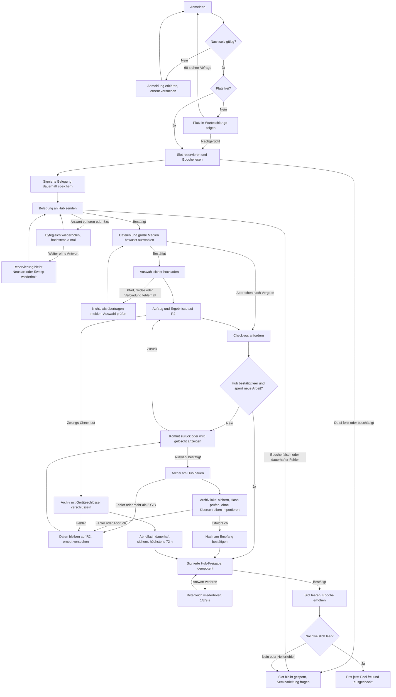

# Sync v1 · bewusster Dateifluss (A7)

Quelle der Klassen: `klassen.json`; identische Testfälle: `faelle.json`.
Kein Hintergrundabgleich, keine Ausführung und kein Überschreiben lokaler Dateien.

## Ordner und Klassifizierung

Lokal: `~/cocopi/{Projekte,Ergebnisse,Skills,Verläufe}` und
`.sync/{archiv,konflikte}`, `.sync/zustand.json`, `.sync/protokoll.jsonl`.
Im Transport heißt der Bereich `Verlaeufe` (lokaler Alias `Verläufe`).
Slot: `~/arbeit/{Projekte,Ergebnisse}`, `~/.pi/agent/{skills,sessions}`.
Archivpfade beginnen immer mit einem der vier Transport-Bereiche.

Erste passende Regel gewinnt: (1) unsichere Pfade und Nicht-Dateien/-Ordner nie;
(2) außerhalb der Bereiche flüchtig; (3) über 200 MiB `gross`, nur ausdrücklich;
(4) unter Ergebnisse alles persönlich, auch Build-Dateien; (5) flüchtige Ordner;
(6) flüchtige Namen/Endungen; (7) übrige Quellen, Skills, Verläufe persönlich.
Damit gewinnt `Ergebnisse/target/demo.exe` gegenüber Cache-Regeln; Größenfreigabe
bleibt unabhängig davon zwingend. Symlinks/Hardlinks in Quellen und Archiven, Geräte und FIFOs nie. Portable Pfade
verwerfen auch Windows-Gerätenamen und Komponenten mit abschließendem Punkt/Leerraum;
Archive mit nur in Groß-/Kleinschreibung verschiedenen Pfaden werden abgewiesen.

## Hub-Vertrag (additiv zu Protokoll v1)

S3 bindet `handleSync(req,res,ctx)` **vor dem JSON-Body-Leser** für `/v1/sync/*`
ein. `ctx` enthält `sync` (mit `createSync({dir,roots})` erzeugt),
`devices` (bestehender DeviceStore). Der Handler authentisiert selbst und erlaubt
nur Desktop-Geräte. `roots` ist eine Abbildung Bereich → absoluter Slot-Pfad;
`dir` liegt im privaten Hub-State und wird beim Slot-Leeren mit gelöscht.
Kein Token in URL. Body-Limits, Origin-Prüfung und Authentisierung vor Upload.

- `POST hoch`: gzip-ustar als Body, `X-Cocopi-Bereich`, `X-Cocopi-Name`
  (ein einzelner Name). Dateien relativ zu Bereich/Name. Nur reguläre Dateien
  und Verzeichnisse. Maximal 2 GiB entpackte Nutzdaten **insgesamt pro Belegung**;
  auch komprimierter Body begrenzt. Dateien über 200 MiB nur nach ausdrücklicher
  Einzeldateiauswahl (`upload_explicit` in Rust) und additivem Header
  `X-Cocopi-Gross: bestaetigt`; Gesamtlimit bleibt. Ziel muss neu
  sein. Temp-Verzeichnis im Ziel-Dateisystem, atomarer Rename nach voller Prüfung.
- Antwort `sync_hoch_ok{bereich,name,dateien,bytes,manifest_sha256}`.
  Manifest `manifest.json`: `{v:1,bytes_hoch,sha256:{"Projekte/Buch/a.md":"…"}}`.
- `POST vorschau {protokoll:1}` → `sync_vorschau{persoenlich:[{pfad,bytes,status}],
  fluechtig:{bytes,dateien,beispiele},gross:[…]}`; Status anhand Upload-Manifest.
- `POST archiv {protokoll:1,auswahl:{zusaetzlich:[],ausschliessen:[]}}` →
  `archiv_bereit{archiv_id,sha256,bytes}`. Persönliche neue/geänderte Dateien
  standardmäßig, nie unveränderte Uploads. `zusaetzlich` gibt große/flüchtige
  Dateien ausdrücklich frei; `ausschliessen` gewinnt. Keine unbekannten Pfade.
- `GET archiv/:id` → gzip-ustar, `X-Cocopi-Sha256`; private Ablage im Slot-State.
  Archive werden bei Check-out durch Slot-Leeren entfernt.

Ustar: 512-Byte-Blöcke, POSIX `ustar\0`, ASCII-Oktalzahlen, UTF-8-Namen,
Prüfsumme, Typ `0`/NUL oder `5`, zwei Nullblöcke am Ende. Keine PAX/GNU-Erweiterungen,
Links, Duplikate, absoluten Pfade, `.`/`..`-Komponenten, Backslashes, Laufwerke,
Steuerzeichen; Rechte auf 0644/0755 normalisiert. Leser begrenzen entpackte Größe,
Header-/Dateizahl und Pfadlänge. Lange Pfade mittels ustar-Prefix (155/100 Bytes).

## Signierter Empfang-Dienstweg

Zusätzlich vor Geräte-Auth an S7 durchreichen: `/v1/sync/dienst/archiv` und
`/v1/sync/dienst/archiv/:id` (beide POST). `ctx.empfangPubkey` ist derselbe Pin
wie A6. Nur echte Loopback-Socketadresse und signierter Auftrag
`{v:1,typ:"sync_dienst",aktion:"archiv"|"holen",slot,checkin_id,iat,nonce,
archiv_id?,erzwungen?,auswahl?,signatur}`. `iat` Unixsekunden ±60 s,
Nonce 32 Byte Base64url, persistent einmalig; Check-in muss gerade belegt sein.
`archiv` liefert `archiv_bereit`, `holen` gzip-Stream. Keine Modell- oder
Geräteberechtigung wird umgangen; ausschließlich Archivbau/-abruf erlaubt.
`auswahl` entspricht Desktop-Auswahl; Empfang leitet sie beim normalen Check-out
weiter. Bei Zwangs-Check-out `erzwungen:true`: auch große persönliche Dateien
werden verschlüsselt gesichert, statt still verloren zu gehen. Über 2 GiB bleibt
Check-out gesperrt (keine stille Löschung). Maximal acht ausstehende Slot-Archive.

## Client-Schnittstellen

`pi-sync` arbeitet nur mit `Read`/`Write`, ohne HTTP. Auswahl zeigt je Bereich/Projekt
persönliche Dateizahl/Größe und ausgelassene flüchtige/große Dateien.
`selection()` ergänzt je Eintrag die Liste `gross:[{pfad,bytes}]`, sortiert nach
Pfad; `pfad` relativ zur Auswahlwurzel (Einzeldatei: ihr Name). Die Pfade lassen
sich nach Einzelbestätigung unverändert an `upload_explicit` übergeben. Summen
`gross_bytes/gross_dateien` bleiben erhalten; nichts aus `gross` ist vorausgewählt.
Archiv erst
als `.sync/archiv/…tar.gz` sichern und SHA256 prüfen. Keine vorhandene Datei wird
ersetzt. Abweichender Inhalt landet daneben als `Name (R2 TT.MM. HH-MM).ext`,
bei Wiederholung mit ` 2`, ` 3` usw. **hinter** der schließenden Klammer und vor
der letzten Endung: `Plakat (R2 28.10. 22-00) 2.psd`. Ohne Endung wird nur der
Zusatz angehängt; `.gitignore` gilt als Name ohne Endung. Bei `Buch.tar.gz` bleibt
nur die letzte Endung außen: `Buch.tar (R2 28.10. 22-00).gz`.
Konflikteintrag in `.sync/konflikte/`.
Identische Dateien benötigen keine zweite Kopie. `.sync/zustand.json` enthält
`v`, `letzter_checkin`, `auswahl`, `manifest`; atomarer Austausch.
Erst nach erfolgreichem Import bestätigt der Aufrufer `erhalten{sha256}`.

## Empfang, Signaturen und Abholfach

Ed25519: öffentliche Schlüssel 32 Byte Base64url, private PKCS8-PEM-Datei 0600.
Signiertes JSON `{...Nutzfelder,signatur:"Base64url"}`; signierte Bytes sind alle
Felder außer `signatur` als rekursiv nach Schlüsseln sortiertes UTF-8-JSON ohne
Leerraum (nur sichere Ganzzahlen). Belegung, Freigabe und
Geräteausweis haben die A6-Inhalte plus `epoche` in Belegung/Freigabe (N3).
`iat`, `exp` und `gueltig_bis` sind Unixsekunden (N4); Challenge-/Tokenfristen,
Warteliste, interne Pool-Zeit und Abholfach-Ablauf bleiben Millisekunden.
`net_pubkey` ist die kleingeschriebene iroh-Knoten-ID in Hex (64 Zeichen), kein
Base64url-Ed25519-Schlüssel.

Desktop-Anmeldung kompatibel mit S3: `POST anmelden/challenge {geraet_id}`,
`POST anmelden {challenge_id,signatur}` → `angemeldet{zugangstoken,…}`; Payload
`cocopi-v1-empfang\n<origin>\nempfang\n<geraet_id>\n<challenge_id>\n<nonce>`.
Token gilt eine Stunde und nur solange dieselbe Belegung besteht.
Zusätzlich Challenge-Payload pro Anfrage (Ed25519, Empfang, kurzlebig/einmalig):
`cocopi-v1-empfang\n<origin>\n<checkin_id>\n<challenge_id>\n<nonce>`.
`POST /v1/empfang/challenge {protokoll:1,checkin_id}` liefert Challenge;
anschließend geschützte Anfragen mit Header `X-Cocopi-Checkin`,
`X-Cocopi-Challenge`, `X-Cocopi-Signatur`. Signiert wird die Challenge; jede
Challenge gilt für genau eine Anfrage. Seminarleitungsaktionen verwenden dieselbe
Prüfung plus serverseitig gespeicherte Rolle. `POST erzwingen {checkin_id}`;
`POST aktiv {verbunden:boolean}` meldet verbundenen Desktop (nur eigenes Konto).

Abholfach: JSON `{v:1,verfahren:"X25519-HKDF-SHA256-AES-256-GCM",checkin_id,
ablauf,ephemeral_pubkey,salt,iv,tag,chiffrat,sha256}`; Binärwerte Base64url,
`sha256` ist der Hash des unverschlüsselten gzip-Archivs. Geräteschlüssel X25519
32 Byte Base64url als `archiv_pubkey` beim Check-in. Zufälliges ephemeres X25519,
HKDF-SHA256 (32-Byte-Salt, info `cocopi-abholfach-v1`, 32 Byte Schlüssel), AES-GCM
mit 12-Byte-IV und 16-Byte-Tag. AAD ist kanonisches JSON der Metadaten ohne
`tag,chiffrat`; bindet ID, Ablauf, Schlüssel und Hash. Maximal 72 h.
Nur authentisierte gleiche `pid` darf `GET abholfach` und `GET abholfach/:id`
abrufen; `POST abholfach/:id/erhalten {sha256}` löscht nach Hashbestätigung.

Normaler Check-out: Archiv bauen → `checkout_bereit{checkout_id,archiv_id,sha256}`;
Client lädt am Hub und bestätigt denselben Hash am Empfang; dann Freigabe am Hub,
Leeren-Helfer, `pruefen` und erst danach Slot frei. `pruefen` muss
`{slot,zustand:"leer"}` (S4) oder im Test `{slot,leer:true}` liefern. Zwangs-Check-out: Archiv bauen,
verschlüsseltes Abholfach dauerhaft speichern, dann gleicher Löschablauf. Bei Fehler
bleibt der Slot gesperrt; niemals Erfolg melden. Hub-Aufrufe laufen über einen
expliziten signierten Service-Adapter; bis S3 die Dienst-Routen vor Geräte-Auth
durchreicht, verweigert der Hub diese Anfragen sicher.

## Epoche, Wiederholung und leerer Abbruch (N1–N6)

Der Empfang liest `<EMPFANG_EPOCHEN_DIR>/accountNN.epoche` vor der ersten
Aktivierung (Standard `/var/lib/cocopi/slots`). Nur sichere nichtnegative Ganzzahl,
reguläre Datei, kein Link. Fehlende/beschädigte Datei sperrt; Epoche 0 ohne Datei
nur mit expliziter Testoption, niemals als Betriebsfallback. Empfang persistiert
die vollständige signierte Belegung **vor** dem ersten Hub-Aufruf. Neustart und
Sweep senden offene Aktivierungen bytegleich erneut. Epoche nie nachträglich an
einer alten Signatur ändern. Freigabe wird ebenfalls vor dem Senden persistiert;
sie trägt dieselbe Epoche wie ihre Belegung. `slotctl leeren` erhöht die Datei;
der nächste Check-in bekommt die neue Epoche.

Belegung/Freigabe: nach Transportfehler oder 5xx höchstens drei Wiederholungen
nach 1/3/9 Sekunden (insgesamt vier Versuche). Permanente 4xx nicht wiederholen.
Hub bestätigt bytegleiche aktive Belegung bzw. bereits erfolgte identische
Freigabe idempotent (N2); abweichender Inhalt bleibt verboten. Archivaufträge mit
Einmal-Nonce werden **nicht** blind wiederholt.

N6 nutzt denselben `POST /v1/empfang/checkout {checkin_id}`. Empfang prüft vor
Archivbau signiert `POST /v1/sync/dienst/leer` mit `aktion:"leer_pruefen"`;
Antwort `sync_leer{leer:boolean}`. Alle vier Sync-Bereiche und Upload-Manifest
müssen leer sein (auch Links und leere Projektordner verhindern Abbruch), kein
Upload darf laufen. Positive Prüfung versiegelt neue Uploads dauerhaft im Slot-State
(`sync-abbruch.json`, beim Slot-Leeren gelöscht), auch über Hub-Neustart hinweg. Zusätzlich muss
S3 im Handler-Kontext `reserveEmptyCheckout()` anbieten: synchron prüfen, dass
noch keine Session gestartet wurde, dann neue Starts bis Freigabe sperren.
Ohne diesen Haken `leer:false`, also normaler Archivweg statt Datenrisiko.
Die Sessionstart-Sperre liegt im S3-Router, nicht in `pi-sync`.

Nur nach positiver Prüfung folgt Hub-Freigabe → Leeren → `pruefen` → Pool frei,
ohne Archiv und ohne Abholfach; Antwort direkt `ausgecheckt`. Desktop muss auch
diese Alternative zu `checkout_bereit` behandeln. Bei vorhandenen Daten oder
fehlender sicherer Prüfung bleibt der normale Archivweg. Fehler beim Leeren
sperrt den Slot; bestätigter leerer Abbruch bleibt persistent fortsetzbar.

## Ablauf Check-in bis Check-out

Das Diagramm beschreibt den Vertrag, keine Betriebs-/UI-Abnahme. Der
S3-Sessionstart-Haken und Desktop-Behandlung der direkten Antwort müssen im
integrierten Stand gesondert nachgewiesen werden.

Einladungen: einmalige zufällige Codes (5 Minuten), nur durch authentisierte
Seminarleitung, Rolle immer `gast`. Logs nur Zeitpunkt, Ereignis und HMAC-pid,
keine Namen/Inhalte/Tokens. Tagesdateien werden nach sieben Tagen gelöscht.
